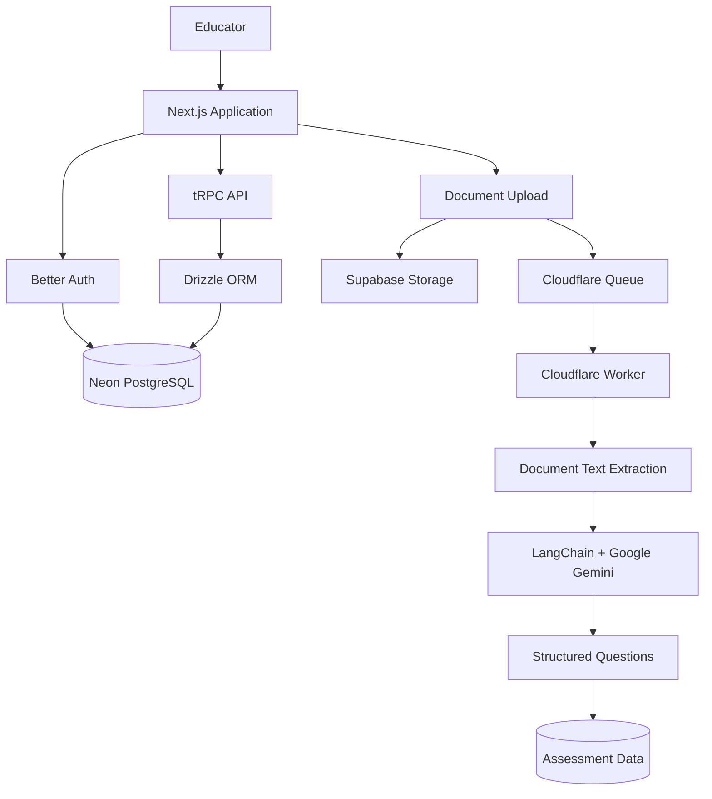

<div align="center">

# AI Quizzer

### Turn learning materials into interactive assessments with AI.

An AI-powered assessment platform that transforms educational documents into structured questions, helping educators create assessments from their existing learning resources.

<br />


[Overview](#overview) ·
[Features](#features) ·
[Architecture](#architecture) ·
[Tech Stack](#technology-stack) ·
[Getting Started](#getting-started)

</div>

---

## Overview

**AI Quizzer** is an AI-powered assessment creation platform designed to streamline the process of generating questions from educational content.

Instead of manually preparing every question, educators can upload learning materials and use AI-assisted document processing to create structured assessments from the provided content.

The application combines a modern web interface, document ingestion pipelines, language models, database integrations, and asynchronous processing infrastructure to support the assessment creation workflow.

### The Problem

Creating high-quality assessments from lecture notes, textbooks, presentations, and other educational resources can be time-consuming.

Educators need a way to turn existing learning materials into usable questions without manually extracting and rewriting every concept.

### The Approach

AI Quizzer brings document processing and AI-assisted question generation into a single workflow.

1. Upload educational documents.
2. Process and extract their textual content.
3. Prepare documents for AI-powered processing.
4. Generate structured assessment questions.
5. Organize and manage assessment-related data through the application.

The goal is to reduce repetitive assessment preparation while keeping the generated questions grounded in the supplied learning materials.

---

## Features

### AI-Powered Question Generation

Use large language models to generate assessment questions from educational content.

- Process document content for AI-assisted question generation.
- Structure generated output for downstream application workflows.
- Support a question-generation pipeline designed around educational assessments.

### Document Ingestion Pipeline

Build a processing workflow that accepts educational documents and prepares them for downstream AI operations.

- Upload documents through the application.
- Extract text from supported document formats.
- Separate document ingestion from subsequent processing tasks.
- Use asynchronous job processing for ingestion workloads.

### Multiple Document Formats

The ingestion workflow is designed to accommodate common educational file formats, including:

- PDF
- DOCX
- PPTX
- XLSX
- TXT
- Markdown
- CSV
- ODT

Actual format support depends on the configured extraction pipeline.

### Asynchronous Processing

Document ingestion can involve computationally expensive operations, external services, and multiple processing stages.

AI Quizzer incorporates queue-based processing to decouple ingestion requests from background work.

- Enqueue document-processing jobs.
- Process jobs asynchronously.
- Use Cloudflare Queues for the queue-based ingestion workflow.
- Keep background processing separate from the primary web application.

### Authentication

Better Auth provides the authentication foundation for the application.

Authentication is integrated with the application's database layer, allowing protected workflows to associate operations with authenticated users.

### Database Integration

The application uses database and storage services for different responsibilities.

- **Neon:** Serverless PostgreSQL database.
- **Drizzle ORM:** Type-safe relational database queries and schema management.
- **Supabase Storage:** Document storage integration.
- **MongoDB:** Document-oriented data persistence where configured.

### Type-Safe Application Architecture

The application uses TypeScript throughout its web stack.

- Type-safe application code.
- Zod-based validation.
- tRPC for typed client-server communication.
- TanStack Query for client-side server-state management.

### Modern User Interface

The frontend is built with Next.js and React, with a component-based interface and reusable UI primitives.

The application also incorporates theme management and client-side state management.

---

## Architecture

AI Quizzer separates the user-facing application from document ingestion and background processing.



*The diagram illustrates the main architectural components. The exact execution path and persistence destination depend on the configured ingestion and question-generation workflows.*

### Architectural Responsibilities

| Component | Responsibility |
|---|---|
| Next.js | Application framework and web interface |
| Better Auth | Authentication |
| tRPC | Type-safe application communication |
| Drizzle ORM | Relational database access |
| Neon | PostgreSQL database hosting |
| Supabase Storage | Document storage |
| Cloudflare Queues | Asynchronous job delivery |
| Document parsers | Text extraction from uploaded files |
| LangChain | AI application and model-integration utilities |
| Google Gemini | Language-model capabilities |
| MongoDB | Document-oriented persistence where configured |
| TanStack Query | Server-state management |
| Zod | Data validation |

---

## Technology Stack

### Frontend

| Technology | Purpose |
|---|---|
| Next.js | React application framework |
| React | Component-based user interface |
| TypeScript | Static typing |
| Tailwind CSS | Utility-first styling |
| Base UI / Radix UI | UI primitives |
| Zustand | Client-side state management |
| TanStack Query | Server-state management |
| GSAP | Animation |
| Lucide React | Icons |

### Backend and Application Layer

| Technology | Purpose |
|---|---|
| Next.js Route Handlers | HTTP endpoints |
| tRPC | Type-safe API communication |
| Better Auth | Authentication |
| Zod | Runtime validation |
| Drizzle ORM | Relational database access |
| Mongoose | MongoDB object modeling |

### AI and Document Processing

| Technology | Purpose |
|---|---|
| Google Gemini | Generative AI |
| LangChain | Model integration and AI workflows |
| PDF parsing utilities | PDF text extraction |
| Mammoth | DOCX text extraction |
| OfficeParser | Office document parsing |
| Textract | Document text extraction utilities |
| Supabase Storage | Uploaded document storage |

### Infrastructure and Data

| Technology | Purpose |
|---|---|
| Neon | Serverless PostgreSQL |
| MongoDB | Document-oriented database |
| Supabase | File storage services |
| Cloudflare Workers | Queue-consumer infrastructure |
| Cloudflare Queues | Asynchronous message processing |
| Docker Compose | Local service orchestration |
| Wrangler | Cloudflare development and deployment tooling |

---

## Getting Started

Follow these instructions to run the application locally.

### Prerequisites

Install the following tools before getting started:

- Node.js compatible with the project's Next.js version
- npm
- Git
- Access to the required database and storage services
- Google Gemini API credentials for AI-powered features
- Cloudflare account and Wrangler CLI if using the deployed queue infrastructure

Additional services may be required depending on which background-processing workflows you enable.

### 1. Clone the Repository

```bash
git clone https://github.com/adarshshukla09-dev/ai-quizzer.git

cd ai-quizzer
```

### 2. Install Dependencies

```bash
npm install
```

### 3. Configure Environment Variables

Create a local `.env` file using the environment-variable names expected by the application.

Configure the credentials and connection strings required for the services you intend to use.

Typical configuration categories include:

| Configuration | Purpose |
|---|---|
| Database connection | Connect to PostgreSQL |
| Authentication secret | Secure authentication sessions |
| Authentication URL | Application's authentication origin |
| Gemini API key | Access generative AI capabilities |
| Supabase URL | Connect to Supabase |
| Supabase service credentials | Perform authorized server-side storage operations |
| MongoDB connection string | Connect to MongoDB where required |
| Queue configuration | Connect to the configured background-processing infrastructure |

**Important:** Use the exact environment-variable names referenced in the source code and deployment configuration. The categories above describe the required configuration areas, not a guaranteed list of variable names.

Never commit API keys, database credentials, authentication secrets, or service-role keys to version control.

### 4. Configure the Database

Ensure that the required database is accessible and configure the connection string.

Generate database migrations when needed:

```bash
npm run db:generate
```

Apply existing migrations:

```bash
npm run db:migrate
```

For development environments where schema pushing is appropriate, the project also provides:

```bash
npm run db:push
```

Inspect the database using:

```bash
npm run db:studio
```

Use the migration workflow appropriate for your environment. Avoid pushing development schemas directly to production without reviewing the changes.

### 5. Start the Development Server

```bash
npm run dev
```

Open:

[http://localhost:3000](http://localhost:3000)

The application should now be accessible locally.

### 6. Configure Background Processing

AI Quizzer includes queue-related infrastructure for asynchronous document ingestion.

The repository contains Cloudflare Worker code for the queue-based workflow.

To use this infrastructure:

1. Review the Worker configuration under `cloudflare/rag-queue/`.
2. Configure the required Cloudflare account and queue resources.
3. Set the environment variables and bindings required by the Worker.
4. Deploy the Worker using the configured Wrangler project.
5. Ensure the application can submit jobs to the configured queue.
6. Verify that the queue consumer processes jobs successfully.

Cloudflare account configuration, queue bindings, and deployment credentials must be configured separately before using the production queue infrastructure.

---

## Project Structure

The repository is organized around the web application, reusable components, database integrations, application logic, and background-processing infrastructure.

```text
ai-quizzer/
├── app/                         # Next.js application and routes
├── components/                  # Reusable UI components
├── cloudflare/
│   └── rag-queue/
│       └── fragrant-darkness-2042/
│           └── src/             # Cloudflare Worker source
├── db/                          # Database integration
├── drizzle/                     # Database migrations
├── lib/                         # Shared utilities and application logic
├── public/                      # Static assets
├── store/                       # Client-side state management
├── trpc/                        # tRPC configuration and routers
├── types/                       # Shared TypeScript types
├── docker-compose.yml           # Local service configuration
├── drizzle.config.ts            # Drizzle configuration
├── next.config.ts               # Next.js configuration
├── package.json                 # Dependencies and scripts
└── README.md
```

Individual modules may contain additional nested files and responsibilities.

---

## Available Scripts

Run these commands from the project root.

| Command | Description |
|---|---|
| `npm run dev` | Start the Next.js development server |
| `npm run build` | Build the application for production |
| `npm run start` | Start the production server |
| `npm run lint` | Run ESLint |
| `npm run db:generate` | Generate database migrations |
| `npm run db:migrate` | Apply database migrations |
| `npm run db:push` | Push the schema to the configured database |
| `npm run db:studio` | Open Drizzle Studio |
| `npm run worker` | Start the configured local worker script |

The `worker` script runs the Node.js worker entry point defined in `lib/utils/worker.ts`. It is separate from the Cloudflare Worker under `cloudflare/rag-queue/`.

---

## Engineering Highlights

AI Quizzer brings together several areas of modern full-stack and AI application development.

### AI Application Development

Integrates language-model capabilities into a document-driven assessment workflow, with structured application logic around generated content.

### Document Processing

Combines document storage, text extraction, and downstream AI processing to prepare educational materials for question generation.

### Asynchronous Job Processing

Uses queue-based infrastructure to separate document-ingestion requests from background processing.

### Type-Safe Full-Stack Development

Combines TypeScript, tRPC, Zod, and Drizzle ORM to support typed application interfaces, validation, and database operations.

### Database and Storage Integration

Separates relational data, document-oriented persistence, and uploaded file storage according to their respective responsibilities.

### Cloud Infrastructure

Includes Cloudflare Worker and Queue configuration for deploying asynchronous processing infrastructure independently of the web application.

---

## Future Improvements

Potential areas for further development include:

- Hybrid retrieval combining semantic similarity and keyword search.
- Improved grounding of generated questions in source documents.
- Source references for generated questions.
- Configurable question types and difficulty levels.
- Improved background-job observability and failure recovery.
- Automated testing for document ingestion and question generation.
- Evaluation pipelines for measuring question quality.
- Production monitoring and performance optimization.

These are potential extensions rather than claims about currently implemented functionality.

---

## Contributing

Contributions, suggestions, and bug reports are welcome.

When proposing a change:

1. Describe the problem or improvement.
2. Keep changes focused and maintainable.
3. Validate the affected workflows.
4. Document any required environment or configuration changes.

---

## License

Refer to the repository's license file for the applicable terms of use.

---

<div align="center">

**AI Quizzer — From educational documents to AI-assisted assessments.**

Built with Next.js, TypeScript, and generative AI.

</div>